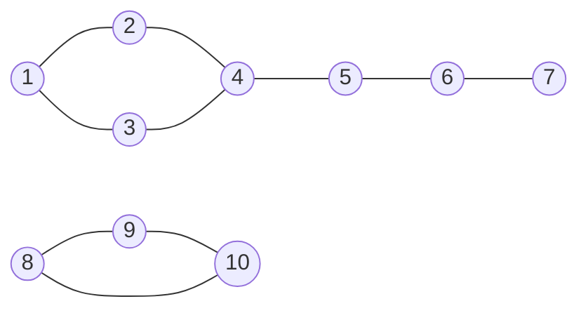
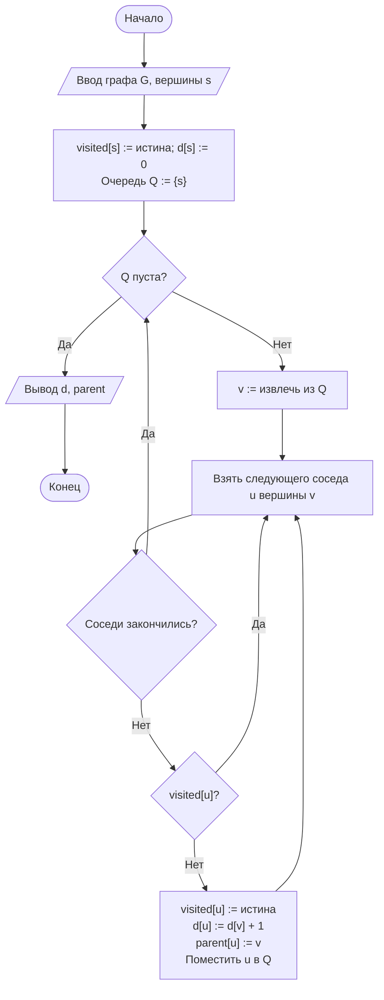
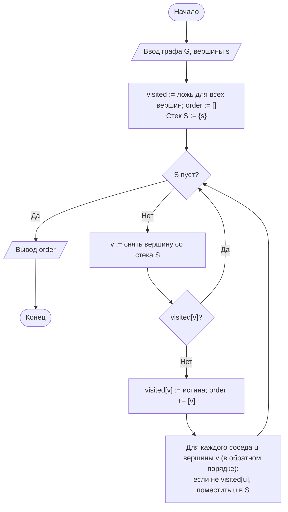

# Лабораторная работа № 9. Способы представления графов и алгоритмы обхода в ширину и в глубину

**Дисциплина:** Теория алгоритмов  
**Направление подготовки:** 38.03.05 «Бизнес-информатика»  
**Выполнила:** Кугушева Арина, группа БИ2-1  
**Вариант:** 13

Файлы работы:

| Файл | Назначение |
|---|---|
| `README.md` | описание работы, результаты и выводы (этот файл) |
| `lab9_variant13.py` | программа: представления графа, BFS и DFS, эксперименты |
| `report_lab9_variant13.pdf` | отчёт с титульным листом, схемами, листингом программы, таблицами и графиками |

---

## 1. Цель работы и задание варианта

**Цель работы:** изучить способы представления графов в памяти, реализовать алгоритмы обхода в ширину и в глубину и экспериментально установить, как выбор представления влияет на расход памяти и время решения типовых задач на графах.

**Исходные данные варианта 13:**

| Параметр | Значение |
|---|---|
| Тип графа | Ц — цепочка (линейный граф), худший случай для глубины рекурсии |
| Ориентированность | неориентированный |
| Размеры $n$ | 5000; 50 000; 100 000 |
| Задача варианта | глубина обхода и память |
| Дополнительное задание | И6 — график зависимости времени обхода от плотности графа при фиксированном $n$ (1 %, 5 %, 20 %, 50 %, 100 % рёбер от максимума); найти точку, где матрица становится выгоднее списков |

## 2. Представления графа и теоретические оценки

Реализованы два класса с одинаковым интерфейсом (`add_edge`, `neighbors`, `has_edge`): `MatrixGraph` (матрица смежности) и `ListGraph` (списки смежности). Для оценки памяти добавлен вариант `MatrixGraphBytes`, где строка матрицы — `bytearray` (1 байт на ячейку).

| Характеристика | Матрица смежности | Списки смежности |
|---|---|---|
| Память | $\Theta(n^2)$ независимо от числа рёбер | $\Theta(n+m)$ |
| Проверка наличия ребра | $\Theta(1)$ | $\Theta(\deg v)$ |
| Перебор соседей вершины | $\Theta(n)$ | $\Theta(\deg v)$ |
| Полный обход (BFS, DFS) | $\Theta(n^2)$ | $\Theta(n+m)$ |

Для цепочки $m=n-1$, то есть списки смежности требуют $\Theta(n)$ памяти и времени, а матрица — $\Theta(n^2)$.

**BFS** использует очередь, посещает вершины по уровням и находит кратчайшие пути в невзвешенном графе. **DFS** использует стек (в работе — явный, итеративная реализация), идёт вглубь и затем возвращается. **Глубина обхода** в работе — это число уровней BFS и глубина дерева обхода DFS; последняя равна максимальной глубине рекурсии рекурсивной версии.

## 3. Тестовый граф и результат обхода

Тестовый граф из 10 вершин и 10 рёбер, две компоненты связности (изображение с деревьями обхода — в PDF-отчёте, рис. 1):



Результат работы программы (одинаков для матрицы и списков):

| Показатель | Значение |
|---|---|
| BFS от вершины 1 | 1, 2, 3, 4, 5, 6, 7 |
| Расстояния от вершины 1 | 1: 0, 2: 1, 3: 1, 4: 2, 5: 3, 6: 4, 7: 5, 8: -1, 9: -1, 10: -1 |
| Дерево BFS (предок → вершина) | 1→2, 1→3, 2→4, 4→5, 5→6, 6→7 |
| DFS от вершины 1 | 1, 2, 4, 3, 5, 6, 7 |
| Дерево DFS (предок → вершина) | 1→2, 2→4, 4→3, 4→5, 5→6, 6→7 (глубина 5) |
| Компоненты связности | {1, 2, 3, 4, 5, 6, 7}; {8, 9, 10} |

Вершины 8, 9, 10 недостижимы из вершины 1, поэтому их расстояние равно −1. Кроме того, программа выполняет 300 случайных тестов (графы до 12 вершин): расстояния сверяются с алгоритмом Флойда — Уоршелла, компоненты — с системой непересекающихся множеств, рекурсивный и итеративный DFS сравниваются по порядку обхода. Все тесты пройдены.

## 4. Блок-схемы алгоритмов

### Обход в ширину



### Итеративный обход в глубину



## 5. Листинг программы

Полный текст — в файле [`lab9_variant13.py`](lab9_variant13.py) и в PDF-отчёте. Основные элементы:

- `MatrixGraph`, `MatrixGraphBytes`, `ListGraph` — представления графа;
- `bfs`, `bfs_stats`, `dfs`, `dfs_tree`, `dfs_recursive`, `connected_components`, `components_dfs` — обходы;
- `make_chain`, `random_edges` — генераторы цепочки и случайного графа заданной плотности;
- `experiment_chain`, `experiment_recursion`, `experiment_density` — замеры; `save_plots` — графики.

Запуск:

```bash
python lab9_variant13.py                 # проверка, замеры и таблицы в консоль
python lab9_variant13.py --plots plots   # дополнительно сохранить графики (нужен matplotlib)
```

Полный запуск занимает около 20 секунд и использует до 250 МБ оперативной памяти (матрица $5000\times5000$ в виде списка списков). Матрица для $n = 50\,000$ и $100\,000$ не строится: для этих размеров приводятся расчётные оценки. Время зависит от компьютера, порядок роста и соотношения между представлениями — нет.

## 6. Результаты измерений

Измерения выполнены в среде Linux, Python 3.13.18. Время — медиана из 5 запусков при отключённом сборщике мусора (для матрицы при n ≥ 2000 — из 3 запусков). Память структур измерена функцией deep_sizeof: она суммирует sys.getsizeof всех объектов, каждый объект учитывается один раз. Память обходов измерена пиком tracemalloc.

**Таблица 1. Цепочка, списки смежности (старт в вершине 0)**

| $n$ | $m$ | Построение, с | BFS, с | DFS, с | Память графа, МБ | Байт на вершину |
|---|---|---|---|---|---|---|
| 5 000 | 4 999 | 0,0012 | 0,0009 | 0,0010 | 0,59 | 124,4 |
| 10 000 | 9 999 | 0,0021 | 0,0016 | 0,0018 | 1,19 | 124,5 |
| 20 000 | 19 999 | 0,0044 | 0,0033 | 0,0036 | 2,38 | 124,7 |
| 50 000 | 49 999 | 0,0127 | 0,0078 | 0,0088 | 5,96 | 124,9 |
| 100 000 | 99 999 | 0,0290 | 0,0156 | 0,0184 | 11,83 | 124,0 |

Рост времени BFS при увеличении $n$: 5 000→10 000: ×1,84, 10 000→20 000: ×2,09, 20 000→50 000: ×2,32, 50 000→100 000: ×2,01 — близко к линейному ($\Theta(n+m)$).

**Таблица 2. Цепочка, матрица смежности (построена реально)**

| $n$ | BFS, с | DFS, с | Память, список списков, МБ | Память, bytearray, МБ |
|---|---|---|---|---|
| 500 | 0,0044 | 0,0044 | 1,94 | 0,27 |
| 1 000 | 0,0185 | 0,0182 | 7,69 | 1,02 |
| 2 000 | 0,0755 | 0,0742 | 30,64 | 3,94 |
| 5 000 | 0,3944 | 0,4211 | 191,04 | 24,15 |

Показатель степени роста времени BFS между $n=500$ и $n=5000$: 1,95 (теория для матрицы: 2). Расчётная формула размера матрицы (число строк × размер строки по `sys.getsizeof`) точно совпала с измерением на всех четырёх размерах.

**Таблица 3. Размеры варианта: матрица (для $n>5000$ — расчёт) и списки**

| $n$ | Матрица (список списков) | Матрица (bytearray) | Списки | Отношение матрица / списки | BFS по матрице, с | BFS по спискам, с |
|---|---|---|---|---|---|---|
| 5 000 | 191,0 МБ | 24,2 МБ | 0,59 МБ | 322 | 0,39 | 0,0009 |
| 50 000 | 19 076,5 МБ\* | 2 387,3 МБ\* | 5,96 МБ | 3 203 | 39,44\* | 0,0078 |
| 100 000 | 76 300,0 МБ\* | 9 542,9 МБ\* | 11,83 МБ | 6 452 | 157,77\* | 0,0156 |

\* Расчёт: матрица не строилась. Память посчитана по формуле, подтверждённой измерением; время получено экстраполяцией по закону $\Theta(n^2)$ от измеренного значения при $n=5000$.

Графики зависимости времени обхода от $n$ и памяти представления — в PDF-отчёте (рис. 4–5).

## 7. Результат решения задачи варианта: глубина обхода и память

**Таблица 4. Глубина обхода и размеры вспомогательных структур**

| $n$ | Старт | Глубина BFS | Макс. очередь BFS | Глубина дерева DFS | Макс. стек DFS |
|---|---|---|---|---|---|
| 5 000 | 0 (конец) | 4 999 | 1 | 4 999 | 1 |
| 5 000 | 2 500 (середина) | 2 500 | 2 | 2 500 | 2 |
| 50 000 | 0 (конец) | 49 999 | 1 | 49 999 | 1 |
| 50 000 | 25 000 (середина) | 25 000 | 2 | 25 000 | 2 |
| 100 000 | 0 (конец) | 99 999 | 1 | 99 999 | 1 |
| 100 000 | 50 000 (середина) | 50 000 | 2 | 50 000 | 2 |

**Таблица 5. Пиковый дополнительный расход памяти самого обхода (списки смежности), МБ**

| $n$ | BFS | DFS (итеративный) |
|---|---|---|
| 5 000 | 0,26 | 0,08 |
| 50 000 | 2,71 | 0,81 |
| 100 000 | 5,33 | 1,53 |

Глубина на цепочке максимальна и равна $n-1$ при старте с конца, но очередь BFS и стек итеративного DFS остаются в пределах 1–2 элементов. BFS расходует больше памяти, чем DFS, потому что хранит расстояния и предков.

**Рекурсивный и итеративный DFS.** Стандартный предел рекурсии Python — 1000. Наибольшая цепочка, которую обходит рекурсивный DFS без изменения предела, — $n=994$.

**Таблица 6. Обход цепочки тремя способами**

| $n$ | Рекурсивный, стандартный предел | Рекурсивный, предел $n+1000$ | Итеративный (явный стек) |
|---|---|---|---|
| 5 000 | сбой: RecursionError | работает, 0,004 с | работает, 0,001 с |
| 50 000 | сбой: RecursionError | работает, 0,016 с | работает, 0,009 с |
| 100 000 | сбой: RecursionError | работает, 0,037 с | работает, 0,024 с |

Второй столбец получен в отдельном процессе с потоком, имеющим стек 512 МБ. Способы обойти ограничение рекурсии: итеративный DFS с явным стеком (используется в работе), повышение `sys.setrecursionlimit` вместе с увеличением стека потока `threading.stack_size`.

## 8. Дополнительное задание И6: время обхода и память в зависимости от плотности ($n=1000$)

Граф со случайными рёбрами, доля рёбер от максимума $n(n-1)/2=499 500$. Время — полный обход всех компонент (BFS и DFS).

**Таблица 7. Время полного обхода, с**

| Плотность | $m$ | BFS, матрица | BFS, списки | DFS, матрица | DFS, списки |
|---|---|---|---|---|---|
| 1 % | 4 995 | 0,0182 | 0,0004 | 0,0186 | 0,0007 |
| 5 % | 24 975 | 0,0163 | 0,0009 | 0,0333 | 0,0026 |
| 20 % | 99 900 | 0,0212 | 0,0038 | 0,0326 | 0,0088 |
| 50 % | 249 750 | 0,0301 | 0,0070 | 0,0406 | 0,0206 |
| 100 % | 499 500 | 0,0316 | 0,0176 | 0,0722 | 0,0423 |

**Таблица 8. Память, МБ**

| Плотность | Матрица (список списков) | Матрица (bytearray) | Списки |
|---|---|---|---|
| 1 % | 7,69 | 1,02 | 0,19 |
| 5 % | 7,69 | 1,02 | 0,51 |
| 20 % | 7,69 | 1,02 | 1,73 |
| 50 % | 7,69 | 1,02 | 4,10 |
| 100 % | 7,69 | 1,02 | 8,48 |

Память списков линейна по $m$: ≈ 0,11 МБ + 17,6 байт на ребро (две ссылки по 8 байт и запас под рост списка).

**Таблица 9. Проверка наличия ребра (20 000 случайных запросов), с**

| Плотность | Матрица | Списки | Списки / матрица |
|---|---|---|---|
| 1 % | 0,0028 | 0,0034 | 1,2 |
| 5 % | 0,0029 | 0,0138 | 4,8 |
| 20 % | 0,0029 | 0,0351 | 12,0 |
| 50 % | 0,0022 | 0,0706 | 31,9 |
| 100 % | 0,0026 | 0,0954 | 36,9 |

**Точка, где матрица выгоднее списков:**

| Критерий | Результат |
|---|---|
| Время полного обхода (BFS, DFS) | не наступает ни при одной из плотностей: при 100 % матрица всё ещё медленнее (BFS в 1,8 раза, DFS в 1,7 раза) |
| Память, матрица из `bytearray` | примерно с 11 % рёбер от максимума |
| Память, матрица из списка списков | примерно с 91 % |
| Проверка наличия ребра | с 1 % матрица не медленнее, с 5 % заметно быстрее (в 4,8 раза) |

Теоретическая оценка для низкоуровневых языков: при 1 бите на ячейку матрицы и 4-байтовых номерах вершин в списках порог по памяти — около $\frac{1}{32}\approx 3\,\%$ рёбер от максимума. В Python пороги выше из-за 8-байтовых ссылок.

Графики — в PDF-отчёте (рис. 6–7).

## 9. Выводы

1. Цепочка — предельно разреженный граф (m = n − 1), и для неё выбор представления определяет, решаема ли задача вообще. Списки смежности занимают 0,59 МБ при n = 5000 и 11,83 МБ при n = 100 000 (около 124 байт на вершину, рост линейный Θ(n)). Матрица смежности при n = 100 000 потребовала бы 74,5 ГБ в виде списка списков и 9,3 ГБ даже в виде байтовых строк, то есть в 6 452 раза больше, чем списки. Построить такую матрицу на обычном компьютере нельзя.
2. Время обхода по спискам растёт пропорционально n + m = Θ(n): при удвоении n время увеличивается в 1,84–2,32 раза, полный обход цепочки из 100 000 вершин занимает 0,016 с (BFS) и 0,018 с (DFS). Обход по матрице квадратичен: на измеренных размерах 500–5000 показатель степени около 1,95, при n = 5000 обход занимает 0,39 с (в 452 раза дольше списков), а экстраполяция на n = 100 000 даёт около 158 с против 0,016 с.
3. Глубина обхода цепочки максимальна: при старте с конца BFS проходит n − 1 уровней, а дерево DFS имеет глубину n − 1; из середины цепочки глубина вдвое меньше (50 000 при n = 100 000). При этом очередь BFS содержит не более одной вершины, а стек итеративного DFS — не более одной (из середины — двух), поэтому собственные структуры обходов занимают O(1). Основная память обхода — массивы d, parent, visited, order размера n: пик составил 5,33 МБ у BFS и 1,53 МБ у DFS при n = 100 000 (BFS хранит ещё расстояния и предков).
4. Рекурсивный DFS на цепочке упирается в предел рекурсии: при стандартном пределе 1000 он обходит цепочку не длиннее 994 вершин, поэтому уже при n = 5000 возникает RecursionError. Обойти ограничение можно двумя способами: перейти на итеративный DFS с явным стеком либо повысить предел sys.setrecursionlimit и запускать обход в потоке с увеличенным стеком (threading.stack_size). Во втором случае при n = 100 000 обход работает в этой среде, но на более старых версиях интерпретатора такой вызов может аварийно завершить процесс, поэтому итеративная реализация надёжнее; она к тому же быстрее (0,024 с против 0,037 с).
5. И6. По времени полного обхода матрица не обогнала списки ни при одной плотности (n = 1000): при 1 % рёбер она медленнее в 44 раза, при 100 % — в 1,8 раза (BFS). Причина: время матрицы почти не зависит от плотности, так как всегда просматриваются все n² ячеек, а время списков растёт с m, но даже при m = n(n−1)/2 остаётся меньше. Выгоднее матрица в двух других отношениях. Память: матрица из bytearray занимает меньше списков начиная с ≈11 % рёбер от максимума, матрица в виде списка списков (8 байт на ячейку-ссылку) — лишь начиная с ≈91 %. Проверка наличия ребра: у матрицы время не зависит от плотности (0,0026 с на 20 000 запросов), у списков растёт (0,0034 с при 1 % и 0,0954 с при 100 %), и уже с 5 % матрица быстрее в 4,8 раза, при 100 % — в 37 раз.
6. Рекомендация по выбору представления. Списки смежности — основной выбор: они подходят для разреженных графов, к которым относятся цепочки, деревья и большинство прикладных графов (m = O(n)), а память и время обхода у них линейны. Матрицу смежности стоит выбирать, если одновременно выполнено три условия: граф плотный (порядка 10–20 % и более от максимума числа рёбер), число вершин невелико, так что n² ячеек помещается в память, и преобладают запросы «есть ли ребро (u, v)». В языках и библиотеках, где матрица хранится как битовый или байтовый массив, порог по памяти ниже, чем у Python-списка списков; в Python для матрицы лучше использовать bytearray.
